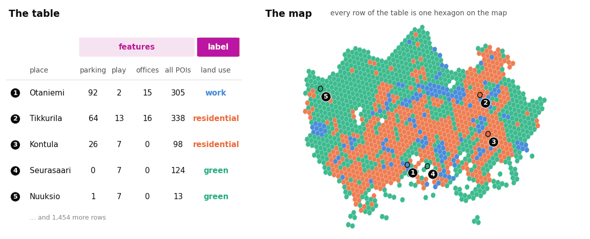

# GeoAI on Helsinki hexagons



A worked example for the two lectures *Machine Learning & GeoAI approaches to spatial data analysis* of the course [GIS-E1130 Introduction to Spatial Data Analysis](https://introsda.readthedocs.io/en/latest/) (Aalto University).

**Lecture slides:** [Introduction to GeoAI, part 1](https://introsda.readthedocs.io/en/latest/lessons/L10/intro-to-GeoAI.html) · [part 2](https://introsda.readthedocs.io/en/latest/lessons/L10/intro-to-GeoAI-2.html), on the course site.

**Two worked examples: Helsinki land use and a simulated courier.** The Helsinki region as 1,459 hexagons. Each hexagon is one row of a table and one place on a map: 16 counts of points of interest and one land-use label, from OpenStreetMap.

## How a page works

Every page is a short notebook. It asks one question and answers it step by step:

1. a line of text,
2. a code cell,
3. its output,
4. the result in one line.

First time, download the zip from [Getting started](setup): it holds all notebooks, the helpers and the data, and a notebook runs inside that folder. [Getting started](setup) also says how to install Python and the packages and how to run the notebooks on your laptop. Each page also shows the slides of the lecture that belong to it.

## The notebooks

```{toctree}
:caption: Start here
:maxdepth: 1

setup
```

```{toctree}
:caption: The data
:maxdepth: 1

data
```

```{toctree}
:caption: Part 1 of the lecture
:maxdepth: 1

learning
unsupervised
supervised
```

```{toctree}
:caption: Part 2 of the lecture
:maxdepth: 1

semi_supervised
self_supervised
reinforcement
spatially_explicit
challenges
```

```{toctree}
:caption: More
:maxdepth: 1

own_data
```

```{toctree}
:caption: The course
:maxdepth: 1

Introduction to Spatial Data Analysis <https://introsda.readthedocs.io/en/latest/>
Lecture: GeoAI, part 1 <https://introsda.readthedocs.io/en/latest/lessons/L10/intro-to-GeoAI.html>
Lecture: GeoAI, part 2 <https://introsda.readthedocs.io/en/latest/lessons/L10/intro-to-GeoAI-2.html>
```

## Seven questions of part 2

| Notebook | Question |
|---|---|
| [The data](data) | What does one row of our table look like on the map? |
| [Supervised learning](supervised) | How well does a fitted model predict hexagons it has not seen? |
| [Semi-supervised learning](semi_supervised) | With 30 labelled hexagons, do the other 1,429 help? |
| [Self-supervised learning](self_supervised) | Can a model describe places without any label? |
| [Reinforcement learning](reinforcement) | How does a robot get from 152 moves to 14? |
| [Spatially explicit models](spatially_explicit) | Which of our models is spatially explicit? |
| [Challenges](challenges) | Can we believe the score? |

## Data and licence

Points of interest and land-use polygons: © OpenStreetMap contributors, Open Database License (ODbL). Hexagons: cells of the H3 grid at resolution 8. Text and figures: CC BY-SA 4.0.
