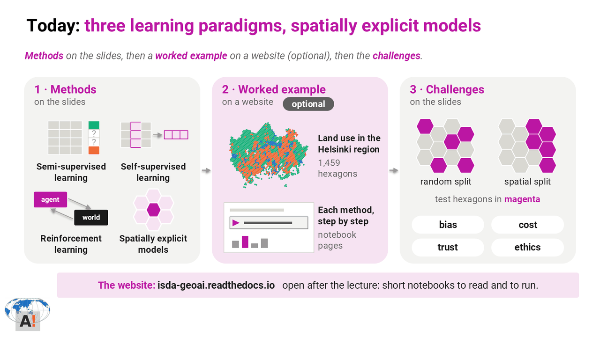
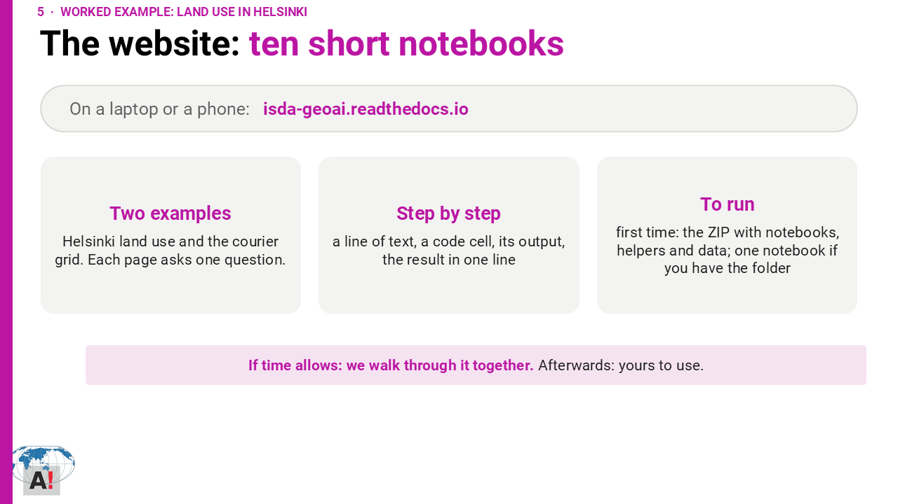

# Getting started

<div class="slides n2"><a href="_static/slides/today.png"></a><a href="_static/slides/website.png"></a></div>
<p class="slides-caption">From the lecture <a href="https://introsda.readthedocs.io/en/latest/lessons/L10/intro-to-GeoAI-2.html">Introduction to GeoAI, part 2</a>. Click a slide to enlarge it.</p>

```{admonition} Question
:class: tip
How do I read the notebooks, and how do I run them on my own laptop?
```

**On this page:** 1 · where the site fits in the lecture  2 · read online  3 · install Python and the packages  4 · download and run  5 · if something goes wrong

## 1 · Where the site fits in the lecture

This site belongs to the course [Introduction to Spatial Data Analysis](https://introsda.readthedocs.io/en/latest/), week 10. The lecture shows each method on slides ([part 1](https://introsda.readthedocs.io/en/latest/lessons/L10/intro-to-GeoAI.html), [part 2](https://introsda.readthedocs.io/en/latest/lessons/L10/intro-to-GeoAI-2.html) on the course site). This site shows the same method on real data: the Helsinki region as 1,459 hexagons. Each page is one short notebook with one question, and opens with the slides that belong to it.

## 2 · Read online

Nothing to install. Every page shows its code and the output of that code. Read the pages in the order of the menu, or open the page of the method you want.

## 3 · Install Python and the packages

You need **Python 3.10, 3.11 or 3.12**. Python 3.13 does not work with the package versions below. Choose one of the two ways.

**A · Miniforge (recommended, any system).** Install [Miniforge](https://github.com/conda-forge/miniforge). Then, in the Miniforge Prompt (Windows) or a terminal (macOS, Linux):

```
conda create -n geoai python=3.11
conda activate geoai
```

**B · Python from python.org.** Install Python 3.11 from [python.org](https://www.python.org/downloads/). Then, in a terminal, in the folder of step 4:

```
python -m venv .venv
.venv\Scripts\activate          # Windows
source .venv/bin/activate       # macOS, Linux
```

Both ways continue with the packages. They are listed in `requirements.txt`, at the versions the site was built with:

```
pip install -r requirements.txt
```

This takes a few minutes.

## 4 · Download and run

1. Download <a href="_static/geoai_hexagons.zip" download>geoai_hexagons.zip</a> (1.6 MB) and unpack it. The folder `geoai_hexagons` holds the ten notebooks, `helpers.py`, `requirements.txt` and the folder `data`.
2. In a terminal, go into that folder and activate your environment of step 3.
3. Start Jupyter: `jupyter lab`. It opens in the browser.
4. Open `data.ipynb` and run the cells from the top (*Run → Run All Cells*).

The first cell should print `1,459 hexagons, 16 features`. Each notebook runs by itself in less than half a minute; `challenges.ipynb` takes about a minute and a half.

To run one page only, download its notebook from the link under its title and put it into the same folder.

## 5 · If something goes wrong

| Message | What to do |
|---|---|
| `ModuleNotFoundError: No module named 'helpers'` | The notebook must lie in the same folder as `helpers.py`. |
| `FileNotFoundError ... helsinki_hex_r8.gpkg` | Keep the folder `data` next to the notebooks. |
| `ModuleNotFoundError: No module named 'geopandas'` (or another package) | Activate the environment of step 3 before `jupyter lab`, or choose it as the kernel in Jupyter. |
| pip fails to build `numpy` or `scipy` | Your Python is 3.13 or newer. Create the environment again with Python 3.11. |

**Next:** [the data](data).
